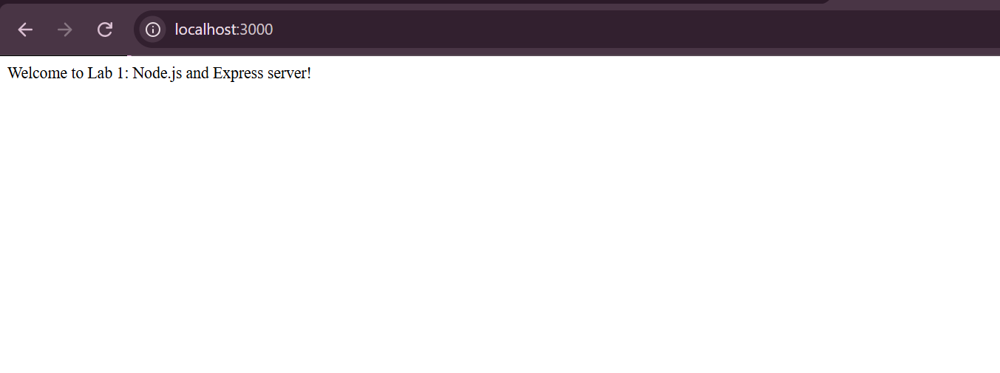
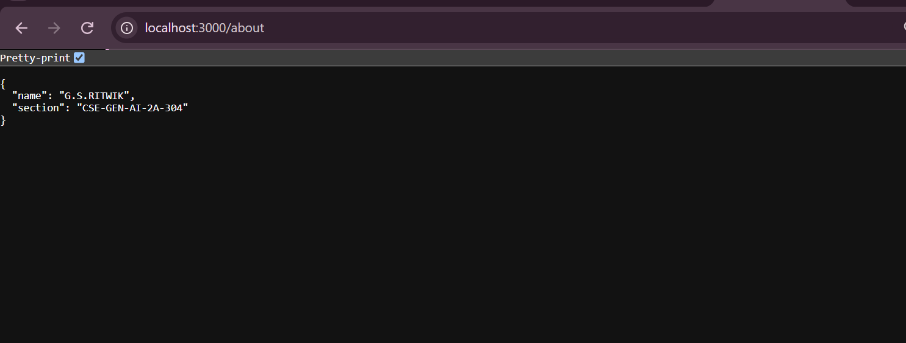
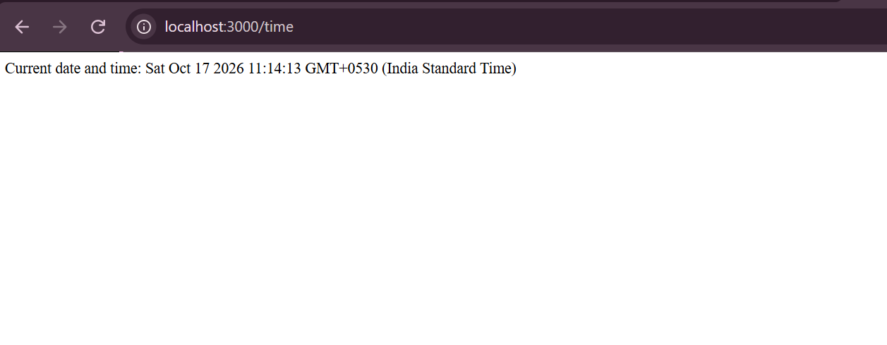
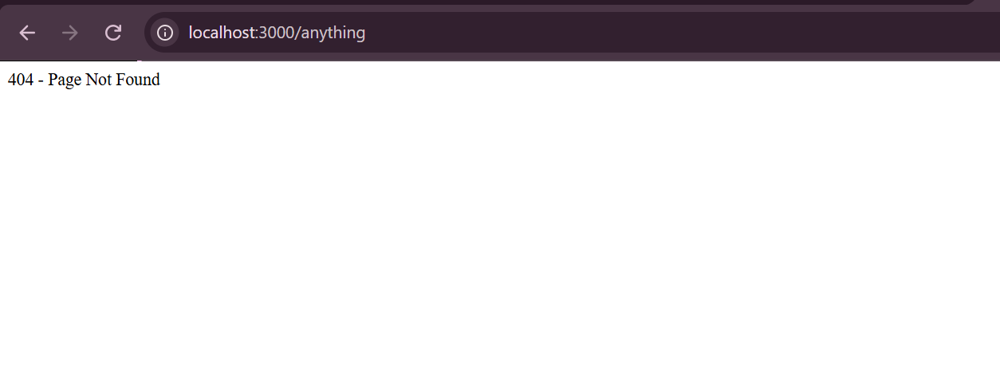

# Lab 1: Node.js and Express Server

## Student Details

- **Name:** Kesav
- **Registration Number:** 252U1R9068
- **Section:** CSE-GENAI-304
- **Course:** Backend Development Fundamentals
- **Lab Number:** 01

## Links

- **GitHub Repository:** https://github.com/kesavkolla6-art/lab_1
- **Live Deployment URL:** https://lab-1-node-server.onrender.com

*(Note: Render's free tier spins down idle services; the first request after inactivity may take up to a minute while the instance spins up.)*

## Objective & Project Explanation

This project demonstrates the core fundamentals of building backend web servers with Node.js and the Express framework:
1. Setting up a Node.js project using `package.json` with appropriate scripts and Node.js 22 LTS engine requirements.
2. Creating a low-level HTTP server using Node's native `http` module (`server-http.js`).
3. Developing a structured Express web server (`server.js`) with multiple GET routes, JSON responses, dynamic date/time output, health checking, and a catch-all 404 error handler.
4. Structuring the project for production deployment on cloud platforms like Render.

## Technologies Used

- **Runtime:** Node.js (v22+ LTS)
- **Framework:** Express.js (v5)
- **Language:** JavaScript (CommonJS)
- **Package Manager:** npm
- **Hosting / Deployment:** Render
- **Version Control:** Git & GitHub

## Project Structure

```
lab-01/
├── screenshots/
│   ├── home.png
│   ├── about.png
│   ├── time.png
│   └── not-found.png
├── server-http.js
├── server.js
├── package.json
├── package-lock.json
├── .env.example
├── .gitignore
└── README.md
```

## Installation and Setup

### Prerequisites

- Node.js (v22 LTS recommended) and npm installed
- Git installed
- Code editor (e.g., Visual Studio Code)

### Steps to Run Locally

1. Clone or download the repository:
   ```bash
   git clone https://github.com/kesavkolla6-art/lab_1.git
   ```

2. Open the project folder in your terminal:
   ```bash
   cd lab-01
   ```

3. Install project dependencies:
   ```bash
   npm install
   ```

4. Start the Express server:
   ```bash
   npm start
   ```
   *(Alternatively, run `node server.js` directly)*

5. Open your browser or API client (Postman/curl) at:
   ```
   http://localhost:3000
   ```

> **Environment Variables:** `PORT` is optional and defaults to `3000` (`process.env.PORT || 3000`). Refer to `.env.example`.

### Running the Native HTTP Server (Part 1)

To run the standalone server built with Node.js's built-in `http` module:
```bash
npm run start:http
```
*(Or `node server-http.js`)*

---

## API Endpoints

### Express Server (`server.js`)

| Method | Endpoint    | Description                                             | Response Format | Expected Status |
| ------ | ----------- | ------------------------------------------------------- | --------------- | --------------- |
| GET    | `/`         | Returns a welcome greeting message                      | Plain text      | `200 OK`        |
| GET    | `/about`    | Returns student information (name, section)             | JSON            | `200 OK`        |
| GET    | `/health`   | Health check returning service status (`{"status":"ok"}`)| JSON            | `200 OK`        |
| GET    | `/time`     | Returns current server timestamp and date               | Plain text      | `200 OK`        |
| GET    | `/*` (e.g. `/anything`) | Catch-all 404 handler for any unregistered route        | Plain text      | `404 Not Found` |

### Built-in HTTP Server (`server-http.js`)

| Method | Endpoint | Description                  | Response Format | Expected Status |
| ------ | -------- | ---------------------------- | --------------- | --------------- |
| GET    | `/`      | Returns "Hello"              | Plain text      | `200 OK`        |
| GET    | `/*`     | Returns "404 - Page Not Found"| Plain text      | `404 Not Found` |

---

## GitHub Instructions

To push the project to your GitHub repository:

1. Open your terminal in the project directory (`lab-01`):
   ```bash
   cd "C:\Users\kesav\Downloads\lab-01 (2)\lab-01"
   ```

2. Initialize Git (if not already initialized):
   ```bash
   git init
   git branch -M main
   ```

3. Configure your remote repository:
   ```bash
   git remote add origin https://github.com/kesavkolla6-art/lab_1.git
   ```
   *(If the remote already exists, update it with `git remote set-url origin https://github.com/kesavkolla6-art/lab_1.git`)*

4. Check status and stage all files:
   ```bash
   git status
   git add .
   ```

5. Commit your changes:
   ```bash
   git commit -m "feat: complete Lab 1 Node.js and Express server with health route and docs"
   ```

6. Push to GitHub:
   ```bash
   git push -u origin main
   ```

---

## Render Deployment Instructions

Follow these steps to deploy the application on Render:

1. **Sign in to Render:**
   - Go to [https://render.com](https://render.com) and log in with your GitHub account.

2. **Create a New Web Service:**
   - Click on **New +** in the top right of the dashboard and select **Web Service**.
   - Select **Build and deploy from a Git repository**.
   - Choose your repository: `kesavkolla6-art/lab_1`.

3. **Configure the Service Settings:**
   - **Name:** `lab-01-express-server` (or any unique name you prefer)
   - **Region:** Select the region closest to you (e.g., Singapore, Frankfurt, Oregon)
   - **Branch:** `main`
   - **Root Directory:**
     - If the repository has files placed directly inside `lab-01/`, set **Root Directory** to `lab-01`.
     - If the files are at the root of the repository, leave **Root Directory** blank.
   - **Runtime:** `Node`
   - **Build Command:** `npm install`
   - **Start Command:** `npm start`
   - **Instance Type:** `Free`

4. **Environment Variables (Optional):**
   - Render automatically assigns a `PORT` environment variable, which `process.env.PORT || 3000` in `server.js` listens to automatically. No manual environment variable setup is required.

5. **Deploy:**
   - Click **Deploy Web Service**.
   - Wait for the build logs to show `Express server running at http://localhost:...`.
   - Once deployed, copy your live onrender URL (e.g., `https://lab-01-express-server.onrender.com`) and test your endpoints:
     - `https://<your-service>.onrender.com/`
     - `https://<your-service>.onrender.com/about`
     - `https://<your-service>.onrender.com/health`
     - `https://<your-service>.onrender.com/time`

---

## Screenshots

### 1. Home Route
Displays the welcome message.


### 2. About Route
Displays the student's name and section in JSON format.


### 3. Time Route
Displays the current date and time.


### 4. Unknown Route (404)
Displays the 404 Page Not Found response.


---

## HTTP Status Codes

- **200 OK:** The request succeeded and the server returned the requested resource.
- **404 Not Found:** The server cannot find the requested resource.

---

## package.json Fields

| Field          | Meaning                                              |
| -------------- | ---------------------------------------------------- |
| `name`         | Project identifier (lowercase, URL-friendly)         |
| `version`      | Current semantic version                             |
| `description`  | Short summary of the project                         |
| `main`         | Server entrypoint file (`server.js`)                 |
| `scripts`      | Command shortcuts (`npm start`, `npm run start:http`)|
| `keywords`     | Descriptive tags for the package                     |
| `author`       | Author name                                          |
| `license`      | Open-source license identifier                       |
| `engines`      | Specifies compatible Node.js runtime versions        |
| `dependencies` | Production packages required at runtime (Express)    |

---

## Viva Questions & Answers

### 1. What is the difference between `package.json` and `node_modules`?
`package.json` holds metadata, dependencies definitions, and scripts for the project, making it portable and lightweight. `node_modules` is the directory where the actual source code of those installed dependencies resides. `node_modules` is excluded from version control via `.gitignore` and can be regenerated at any time using `npm install`.

### 2. What does `app.listen()` do?
`app.listen()` binds and listens for connections on the specified host and port, enabling the Express server to receive incoming HTTP requests.

### 3. What do `req` (request) and `res` (response) represent?
- `req` (Request object): Contains data regarding the incoming HTTP request, including route parameters, query strings, headers, and the HTTP request body.
- `res` (Response object): Provides methods used to craft and send HTTP responses back to the client, such as setting status codes (`res.status()`), sending JSON (`res.json()`), or returning plain text/HTML (`res.send()`).

---

## Git and Repository Notes

- The `.gitignore` file strictly excludes `node_modules/` and `.env` files.
- The `screenshots/` directory is tracked to verify endpoint outputs.
- Submissions are managed via the GitHub repository.
